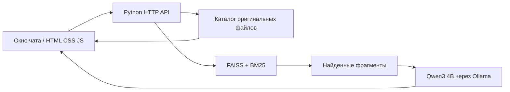

# Ассистент НГТУ

Локальный чат по открытым страницам и документам Нижегородского государственного
технического университета им. Р.Е. Алексеева. Находит материалы в базе знаний,
составляет ответ с помощью Qwen и показывает ссылки на первоисточники.

**Текущий комплект: r23, 16 173 чанка, 1 024 координаты на вектор.** Готовый
индекс уже рассчитан. Для работы на другом устройстве повторная векторизация не нужна.

## Скачать только приложение

[**Скачать Чат НГТУ для Windows — ZIP**](https://media.githubusercontent.com/media/ReFleX9/nntu-rag-bot/main/distribution/nntu-desktop-win.zip)

Это отдельный комплект: интерфейс, необходимые Python модули, готовый FAISS
индекс и каталог из 6 139 записей оригинальных файлов. История Git,
исходный архив сайта и промежуточные варианты корпусов в него не входят.
Размер и SHA-256 ZIP опубликованы в [distribution/manifest.json](distribution/manifest.json).
Для скачивания этого ZIP не требуются Git и Git LFS.

### Установка на Windows

1. Установите [Python 3.11–3.13 x64](https://www.python.org/downloads/windows/)
   с компонентами **pip, Tcl/Tk и Python Launcher**. При установке включите
   добавление Python в PATH. Microsoft Edge должен быть установлен.
2. Скачайте ZIP по ссылке выше и распакуйте его в постоянную папку,
   например `C:\Apps\nntu-chat`. Не запускайте программу внутри ZIP.
3. Дважды нажмите **Install.cmd**. Установщик создаст отдельное окружение
   `.venv`, поставит библиотеки, скачает embedding модель и portable Ollama,
   затем модель ответов `qwen3:4b`. Первичная установка требует интернета.
4. После сообщения об успешной установке появится ярлык **«Чат НГТУ»**
   на рабочем столе. Дважды нажмите его и дождитесь загрузки базы.
5. Задавайте вопросы. **Закройте окно чата крестиком**, когда закончите:
   приложение остановит собственные процессы сайта и моделей.

После установки также работает **Start.cmd** из папки приложения.
Установщик не добавляет программу в автозагрузку. Не перемещайте установленную
папку: конфигурация и ярлык содержат абсолютные пути. Если папку перенесли,
повторите `Install.cmd`, чтобы пересоздать настройки и ярлык.

Код доступа в окне подставляется автоматически. Сайт слушает только
`127.0.0.1:18080`, отдельная Ollama — `127.0.0.1:11435`; доступ из интернета
не открывается. Закрытие окна во время генерации отменяет текущий ответ.
Сохранённый индекс от этого не изменяется. Принудительное завершение самого
запускателя через Диспетчер задач не заменяет обычное закрытие окна.

### Требования и объём загрузки

- Windows x64, версия 10 22H2 или новее; desktop установщик рассчитан на Windows.
- Практический ориентир: **16 ГБ ОЗУ**, предпочтительно 24–32 ГБ; скорость
  зависит от процессора и доступной видеопамяти. Работа на 8 ГБ не проверена.
- Оставьте **15 ГБ свободного места** под окружение, модели, загрузочные
  архивы и распаковку. Полный объём зависит от установленных библиотек.
- Embedding модель занимает около 1,2 ГБ; Qwen3 4B Q4_K_M — около 2,5 ГБ;
  portable Ollama v0.40.16 скачивается отдельным архивом около 1,6 ГБ.
  Дополнительно скачиваются PyTorch и другие Python библиотеки.
- Интернет нужен для первой установки и открытия ссылок на оригинальные
  документы. Поиск и генерация после установки работают локально.

Embedding расчёт запросов по умолчанию идёт на CPU. Ollama выбирает доступное
ускорение модели ответов. На исходном ПК с Radeon RX 560 и примерно 24 ГБ ОЗУ
первый запрос занял 88 секунд, включая загрузку модели; поиск занял 1,2 секунды,
генерация — примерно 3,6 токена/с. Это один замер, не обещание скорости на другом ПК.

## Как устроен проект



| Часть | Реализация |
|---|---|
| Окно программы | Python / Tkinter для запуска, Microsoft Edge в режиме приложения |
| Интерфейс | HTML, CSS, JavaScript; оформление со знаком и цветами НГТУ |
| API сайта | Python `ThreadingHTTPServer`, `POST /api/ask`, `GET /health` |
| Поиск | FAISS `IndexFlatIP`, нормализованные векторы; BM25; объединение RRF |
| Эмбеддинги | Qwen3-Embedding-0.6B, 1 024 координаты, рабочий предел 2 400 токенов |
| Ответы | Qwen3 4B Q4_K_M, Ollama, LangChain |
| Данные | JSONL с текстом, URL, страницами и идентификаторами чанков |

Обычный режим использует до 6 результатов и контекст до 7 000 символов;
подробный — до 10 результатов, соседние чанки и до 14 000 символов.
LLM получает только найденные фрагменты, а не весь архив университета.
Один экземпляр сайта обрабатывает один вопрос за раз.

Установщик нового ПК скачивает официальную `qwen3:4b`. Исходная установка
использует локальное имя `nntu-qwen:4b` для GGUF той же модели/квантизации.
Точное совпадение результатов между установками не гарантировано.
Embedding модель, напротив, закреплена ревизией
`97b0c614be4d77ee51c0cef4e5f07c00f9eb65b3` и проверяется по хэшам весов и токенизатора:
это необходимо для совместимости с готовым индексом.

## Что содержится в базе и каковы ограничения

Исходный обработанный корпус содержит **244 601 чанк**. Версия r23 выбирает
16 173 фрагмента для основного поиска. Количество чанков не является
процентом сохранённых знаний. Отдельные статьи, программы дисциплин,
таблицы, исторические и служебные материалы представлены лишь частично.

Полные сложные документы доступны по ссылкам через каталог оригиналов.
Каталог содержит записи о файлах, сами PDF/DOCX в минимальный комплект не
включены. Для некоторых типов действует подбор по группе/году/виду документа,
для остальных поиск по точному имени. Произвольный подбор любого пособия по
теме пока не гарантирован. Ответы и актуальность нормативных документов
нужно сверять с первоисточниками.

Целостность собранного r23 проверена: 16 173 уникальных ID в исходном порядке,
совпадение текстов, хэши файлов, размеры и нормализация векторов. Широкая
оценка качества ответов и полноты корпуса ещё не завершена. Подробности отбора:
[03](docs/CATEGORY03_LITERATURE.md), [04](docs/CATEGORY04_SELECTION.md),
[06](docs/CATEGORY06_SELECTION.md), [07](docs/CATEGORY07_SELECTION.md),
[08](docs/CATEGORY08_SELECTION.md), [99](docs/CATEGORY99_SELECTION.md).

## Структура репозитория

| Папка | Назначение |
|---|---|
| `desktop_chat/` | Программа, установщик, упаковка, значок |
| `distribution/` | Минимальный готовый ZIP и его SHA-256 |
| `rag_hybrid_langchain/rag_hybrid/` | Поиск, ответы, HTTP API, интерфейс |
| `deploy/` | Подготовка корпусов, аудит, серверные сценарии |
| `distributed_embedding/` | Векторизация на двух ПК и управление через Telegram |
| `distributed_embedding/transfer/` | Рассчитанные шарды и их сборка |
| `docs/` | Решения об отборе, ограничения и результаты ревизий |
| `backups/` | Архивы предыдущих корпусов и рабочего серверного индекса |
| `site_crawler/`, `chanker/` | Сбор сайта и формирование чанков |

В Git не попадают `.venv`, `vendor`, `work`, токены, Telegram ID из локальных
настроек, журналы, профили браузера и локальные пути запуска. Исходный корпус
и архивы резервных копий хранятся через Git LFS. Прежний серверный вариант
на 10 486 чанков сохранён отдельно; новый desktop комплект использует r23.

## Для разработки и восстановления

Чтобы получить код без скачивания всех больших объектов:

```powershell
$env:GIT_LFS_SKIP_SMUDGE='1'
git clone https://github.com/ReFleX9/nntu-rag-bot.git
cd nntu-rag-bot
```

Для обычного использования скачивайте готовый ZIP. В клоне `Install.cmd`
ожидает распакованные `runtime/index/` и `runtime/file_catalog.jsonl` из этого
ZIP; одних исходников недостаточно. Для конкретных резервных копий используйте
`git lfs pull --include="нужный/путь/*" --exclude=""`, не скачивая весь архив.

Повторная векторизация и объединение описаны в
[distributed_embedding/README.md](distributed_embedding/README.md).
Telegram управление прогрессом и выключением ПК — в
[distributed_embedding/TELEGRAM.md](distributed_embedding/TELEGRAM.md).
Токен бота вводится локально и не нужен обычному desktop чату.

Пакет собирается явным списком файлов через `desktop_chat/build_package.py`.
SHA-256 содержимого записываются в `desktop_chat/payload.json`, SHA-256 ZIP —
в `distribution/manifest.json`. Сценарий установки проверяет комплект до
скачивания моделей. Пути к индексу, моделям и Python на установленном ПК
находятся в `work/desktop_chat.json`.

При ошибке запуска смотрите `work/desktop_server.log`,
`work/desktop_ollama.log`, `work/desktop_browser.log`. Если порты заняты,
закройте предыдущий экземпляр приложения. При нехватке памяти начните с
обычного режима поиска и закройте другие тяжёлые программы.

## Источники и компоненты

Материалы университета: [nntu.ru](https://www.nntu.ru/).
Знак и палитра: [фирменный стиль НГТУ](https://www.nntu.ru/content/universitet/simvolika-i-firmennyi-stil).
Модели: [Qwen3-Embedding-0.6B](https://huggingface.co/Qwen/Qwen3-Embedding-0.6B)
и [Qwen3 4B в Ollama](https://ollama.com/library/qwen3:4b).
[Ollama для Windows](https://docs.ollama.com/windows).
Проект является учебной разработкой; использование знака не означает
официального статуса сервиса университета. Права и лицензии сторонних
моделей, библиотек и документов принадлежат соответствующим владельцам.
